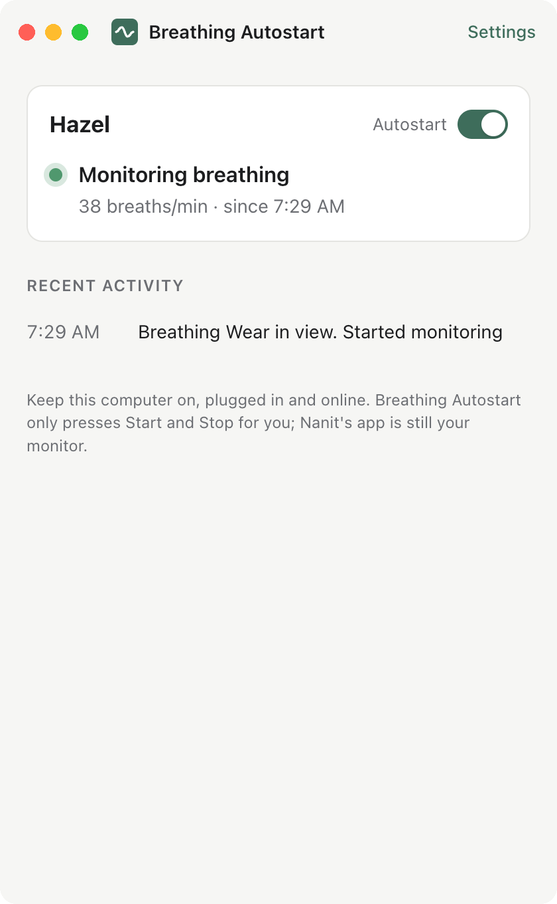

# Breathing Autostart for Nanit

A small Mac and Windows app that starts Nanit's Breathing Motion monitoring when your baby is put down wearing Breathing Wear, and stops it when they're picked up. No more opening the Nanit app at 3 AM to press Start, and no more "Monitoring stopped" pop-ups after every pickup.

**Download:** [Mac (Apple silicon)](https://github.com/jackwallner/nanit-breathing-autostart/releases/latest/download/Breathing-Autostart-mac-arm64.dmg) · [Mac (Intel)](https://github.com/jackwallner/nanit-breathing-autostart/releases/latest/download/Breathing-Autostart-mac-x64.dmg) · [Windows](https://github.com/jackwallner/nanit-breathing-autostart/releases/latest/download/Breathing-Autostart-Setup.exe)

Project page: [jackwallner.com/breathing-autostart](https://jackwallner.com/breathing-autostart/)

<p align="center"></p>

> Breathing Autostart is not made by, endorsed by or affiliated with Nanit. It is not a medical device and does not monitor your baby. It only presses Start and Stop in Nanit's own Breathing Motion monitoring for you. Nanit's app is still your monitor, and its alerts work exactly as before.

## What you need

- A Nanit camera with Breathing Motion monitoring and Breathing Wear (a band, swaddle or sleep bag).
- A Mac (macOS 11 or later) or Windows 10/11 PC that stays on, awake and online near the time your baby sleeps. It does not have to be on the same Wi-Fi as the camera.

## Setup

1. Download and open the installer for your computer.
   - **Mac:** open the disk image and drag Breathing Autostart to Applications.
   - **Windows:** run `Breathing-Autostart-Setup.exe`. It installs for your user account without asking for an administrator.
2. Sign in with your Nanit email and password, then type the code Nanit texts or emails you.
3. That's it. The app lives in the menu bar (Mac) or system tray (Windows), opens at login, and keeps the computer from going to sleep while it's working.

## How it works

The app signs in to Nanit the way Nanit's own app does and keeps a connection to your camera through Nanit's cloud.

- **Starting.** About twice a minute it looks at a small version of the camera picture. When the picture changes (someone is putting the baby down), it sends a frame to Nanit's own Breathing Wear finder, the same check the app's one-tap start uses. If Nanit finds the band, it starts monitoring at that spot.
- **Stopping.** When the camera reports the baby is out of bed, or can't see the band for 8 minutes, it stops the session before Nanit's full-screen "Monitoring stopped" or "Stop monitoring?" dialogs appear. You'll see a short "stopped by" note in the Nanit app instead.
- **Brief moments are left alone.** A quick lift or a blanket over the band doesn't end anything. If the band shows up somewhere else in the bed, monitoring restarts there.
- **Your stop wins.** If you stop monitoring in the Nanit app yourself, autostart waits until your baby is picked up before it starts again (you can turn this off in Settings).
- **No loops.** A session that ends within three minutes, or never picks up breathing, makes autostart wait 10 minutes (then 30) before trying again.
- **Quiet when not needed.** While monitoring runs normally, the app stops reading the video.

## Privacy and security

- Your password goes straight to Nanit and is never saved. The app keeps only Nanit's sign-in tokens, encrypted by your computer's keychain (Mac) or Windows Data Protection.
- The app talks only to Nanit (`api.nanit.com` and Nanit's video relay) and to GitHub to check for updates. There is no server of ours and no analytics.
- The video connection checks Nanit's certificate against your operating system's trusted roots.
- Logs (for troubleshooting) stay in the app's data folder and contain no passwords or tokens. Settings → Log files opens the folder.

## Good to know

- Run it on one computer per camera. Two copies would both try to start and stop monitoring.
- Nanit shows "monitoring was stopped by <your name>" when the app stops a session. That's Nanit's note about who pressed Stop; it can't be turned off.
- If the computer sleeps, loses internet, or Nanit changes how its service works, autostart stops working and you'll get a notification. Start monitoring in the Nanit app as usual until it's back.
- It reads the camera's video while your baby is out of bed, so it uses about as much internet as having Nanit's live view open.
- **Mac:** the app is signed and notarised by Apple, so it opens like any other app.
- **Windows, first open:** if SmartScreen says "Windows protected your PC", click **More info** → **Run anyway**. The installer isn't code-signed yet.

## Development

```sh
npm ci
bash scripts/build-ffmpeg.sh mac-arm64   # or mac-x64; Windows builds cross-compile on Linux
npm test                                 # engine and unit tests (uses the bundled ffmpeg)
npm run test:app                         # drives the app window against a fake Nanit
npm start
npm run dist:mac                         # or dist:win
```

The engine (`src/engine`) is plain Node and knows nothing about Electron. `test/fake-nanit.js` stands in for Nanit's API and camera relay, so every test runs without a Nanit account. The camera protocol's field numbers come from Nanit's Android app.

The bundled ffmpeg is built from source by `scripts/build-ffmpeg.sh` as a small LGPL build with only what the app needs (RTMPS, H.264, PNG), using the operating system's TLS.

## License

MIT. See [LICENSE](LICENSE) and [THIRD_PARTY_NOTICES.md](THIRD_PARTY_NOTICES.md). "Nanit" and "Breathing Wear" are trademarks of Nanit, used here only to say what this app works with.
